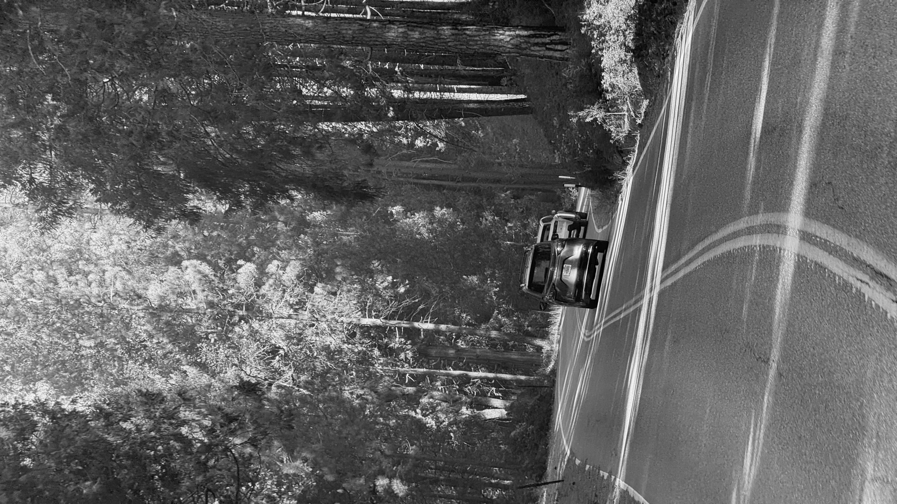
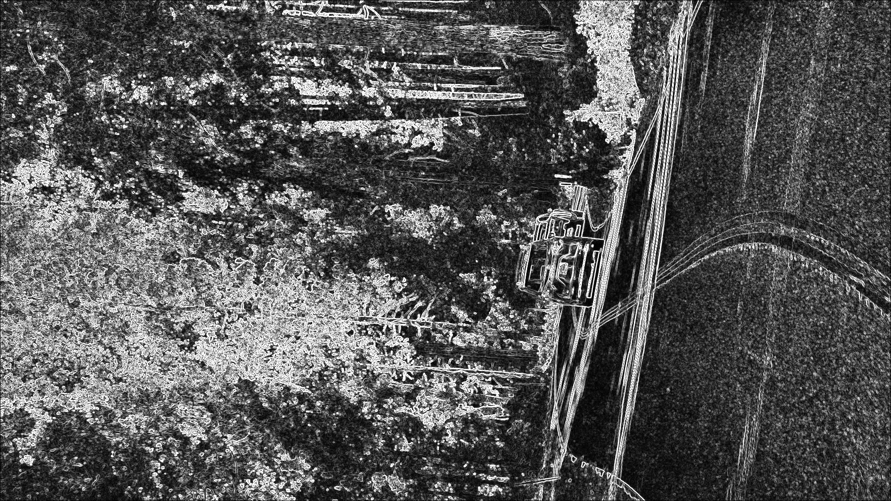

# CUDA-Accelerated-Image-Processing

**GPU Parallel Computing | CUDA C++ | Image Processing | Performance Optimization**

## Overview

This project implements GPU-accelerated grayscale conversion and Sobel edge detection using NVIDIA CUDA C++. It explores how parallel computing can improve image-processing performance through CPU/GPU benchmarking, memory-transfer analysis, and CUDA thread-block optimization.

The project uses real-world road imagery as a test workload, demonstrating fundamental image-processing operations relevant to computer vision and autonomous driving.

## Key Features

- **CUDA Grayscale Conversion:** Parallel RGB-to-grayscale conversion using GPU threads.
- **Sobel Edge Detection:** GPU-based detection of image gradients and object boundaries.
- **CPU/GPU Benchmarking:** Comparison of execution times using CPU timing utilities and CUDA Events.
- **Thread-Block Optimization:** Evaluation of multiple CUDA thread configurations to improve GPU kernel performance.
- **Output Validation:** Pixel-level comparison of CPU and GPU Sobel implementations.

## Technical Implementation

Each CUDA thread processes an individual image pixel. The grayscale kernel calculates luminance from RGB values, while the Sobel kernel computes horizontal and vertical intensity gradients using a 3 × 3 neighborhood.

CUDA memory-management operations transfer image data between host and device memory.

Performance experiments investigate the impact of kernel execution, host-device memory transfers, and thread-block configurations.

## Benchmark Results

**Hardware:** NVIDIA Tesla T4 GPU (Google Colab)  
**Resolution:** 1920 × 1080 (2,073,600 pixels)

### Grayscale Conversion

| Metric | Measured Result |
|---|---:|
| CPU execution time | 4.8806 ms |
| GPU kernel execution time | 0.0493 ms |
| Kernel-only speedup | 98.90× |
| GPU end-to-end execution time | 2.0338 ms |
| Preliminary end-to-end speedup | 2.40× |

The results demonstrate the importance of distinguishing GPU computation time from total processing latency, including host-device memory transfers.

### Sobel Edge Detection

| Metric | Measured Result |
|---|---:|
| CPU execution time | 14.5717 ms |
| Best GPU kernel time | 0.0333 ms |
| Preliminary kernel-only speedup | 437.6× |
| Maximum CPU/GPU pixel difference | 0 |

### CUDA Thread-Block Optimization

Median kernel execution times from five repeated benchmark runs:

| Thread Block | Median Time |
|---|---:|
| 8 × 8 | 0.0982 ms |
| 16 × 16 | 0.0489 ms |
| 32 × 8 | **0.0333 ms** |
| 32 × 16 | 0.0382 ms |

The 32 × 8 configuration achieved the lowest median execution time in these experiments, reducing kernel execution time by approximately **31.9%** relative to the 16 × 16 baseline.

**Benchmark note:** Kernel-only measurements exclude CPU-to-GPU and GPU-to-CPU memory transfers. Results are workload- and environment-dependent. CPU and GPU baselines use different execution architectures, and the reported speedups should be interpreted as preliminary measurements rather than universal performance guarantees.

## Image Processing Results

### Grayscale Conversion



### Sobel Edge Detection



The Sobel implementation highlights intensity changes corresponding to road boundaries, lane markings, vehicle contours, and surrounding environmental structures. It is a general-purpose edge detector, not a complete lane-detection or object-recognition system.

## How to Run

**Requirements:**

- NVIDIA CUDA-capable GPU
- NVIDIA CUDA Toolkit with `nvcc`
- C++ compiler
- Python with Pillow and NumPy for image preparation and visualization

The current implementation uses a fixed resolution of 1920 × 1080.

Prepare an RGB image as `input.rgb` using Python:

```python
from PIL import Image
import numpy as np

img = Image.open("road.jpg").convert("RGB")
img = img.resize((1920, 1080))
np.asarray(img, dtype=np.uint8).tofile("input.rgb")
```

Compile and run the CUDA grayscale implementation:

```bash
nvcc -O2 image_cuda.cu -o image_cuda
./image_cuda
```

Run the CPU/GPU grayscale benchmark:

```bash
nvcc -O2 benchmark.cu -o benchmark
./benchmark
```

Run the optimized Sobel GPU implementation:

```bash
nvcc -O2 sobel_32x8.cu -o sobel
./sobel
```

Run the CPU Sobel baseline:

```bash
g++ -O2 sobel_cpu.cpp -o sobel_cpu
./sobel_cpu
```

The programs generate raw grayscale outputs. These can be visualized using Python, Pillow, and NumPy.

## Engineering Insights

- GPU parallelism can substantially reduce compute-bound kernel execution time.
- Host-device memory transfers can significantly reduce end-to-end speedup.
- Thread-block geometry influences GPU execution efficiency.
- Repeated measurements and output validation are essential for meaningful performance comparisons.

## Future Improvements

- Shared-memory optimization for Sobel convolution.
- Gaussian filtering to reduce image noise.
- Additional benchmarks across 720p, 1080p, and 4K workloads.
- More systematic end-to-end latency measurements.
- Automated build, testing, and benchmarking workflows.
- Evaluation of image-processing pipelines on autonomous-driving datasets.

## Technologies

**Languages:** CUDA C++, C++, Python  
**GPU:** NVIDIA Tesla T4  
**Tools:** NVIDIA CUDA Toolkit, Google Colab, NumPy, Pillow  
**Concepts:** GPU Parallelism, CUDA Kernels, Memory Transfers, Sobel Filtering, Performance Benchmarking
